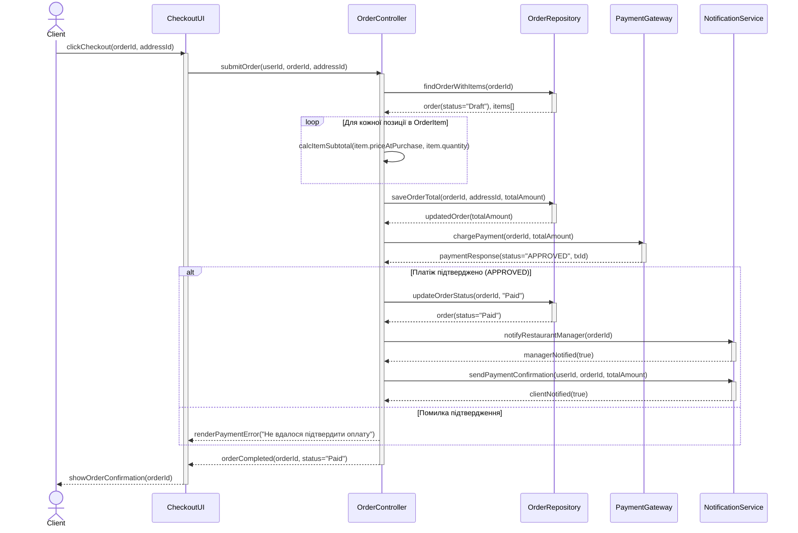
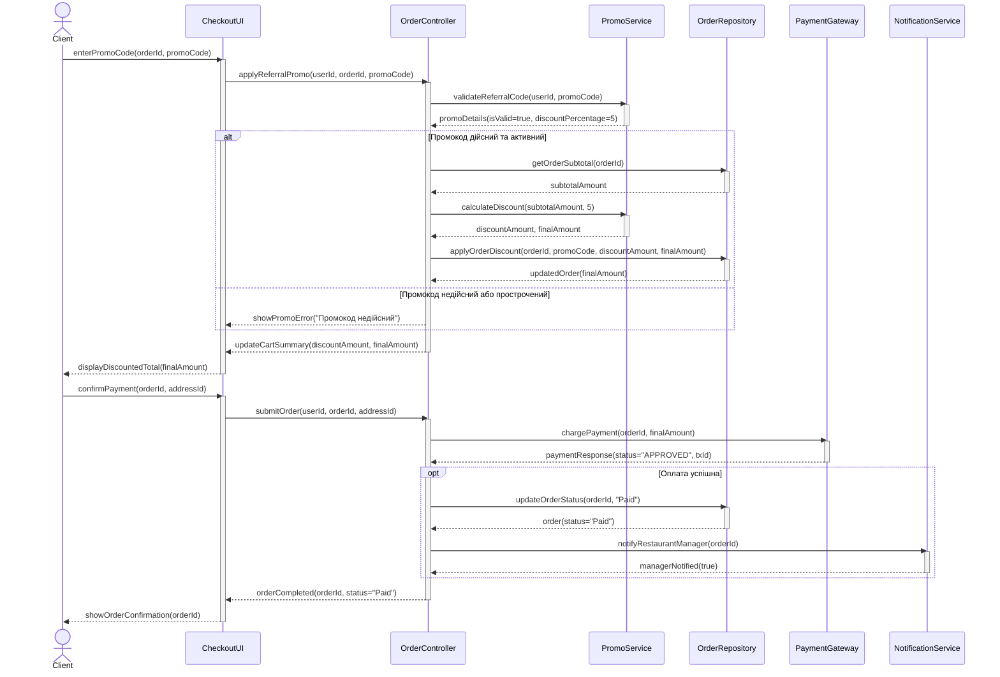
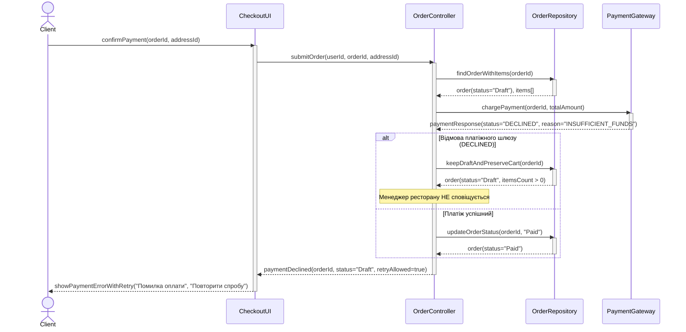
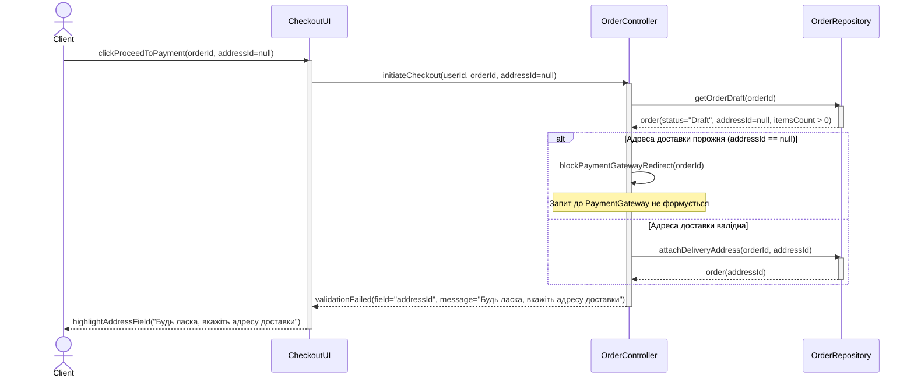

# Діаграми послідовності (Sequence Diagrams — FoodDelivery)

## SC-01: Успішне оформлення та оплата замовлення (Happy Path)

---

## SC-02: Застосування реферального промокоду перед оплатою (Альтернативний шлях)

---

## SC-03: Відмова платіжної системи під час оплати (Помилковий шлях А)

---

## SC-04: Спроба оформлення замовлення без вказаної адреси доставки (Помилковий шлях Б)

